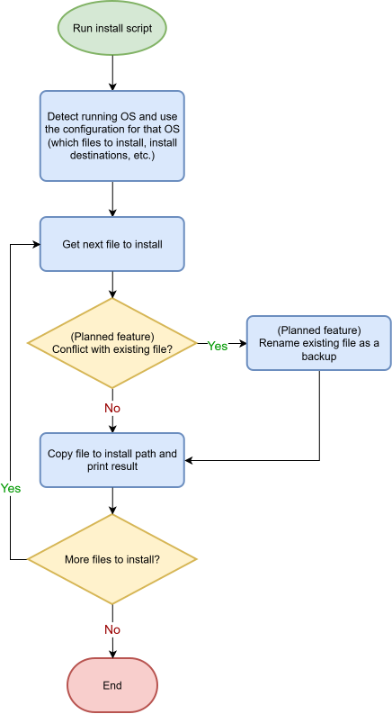

# runtime_components_2

Cross-platform configs

Project goal: A cross-platform runtime-components (from CS 193 homework 5) written in Python that allows you to install configs on Windows and Linux.
## The Problem

[runtime-components](https://github.com/Why-Am/runtime-components) (from CS 193 homework 5) is a cool idea but it does not work on Windows.

I use Windows.

I use Windows programs that use config files.

My vim config is the same between Windows and Linux, but one is stored in `AppData` and the other is stored in `$HOME`.

I want unity.

Also, bash is hard to read.

## MVP Scope

- [x] Command line interface
- [x] Install Windows configs
- [x] Install Linux configs

## Future plans

- [x] Dry run
- [ ] Ad hoc install instructions
- [ ] Backup overwritten files
- [ ] Install macOS configs

## Tech Stack

- Language: Python
- Libraries: os, path
- External tools: git, GitHub
- Data storage: plain text for the configuration files and their backups

## Diagrams

### Configuration Install Flow

### User Flow

