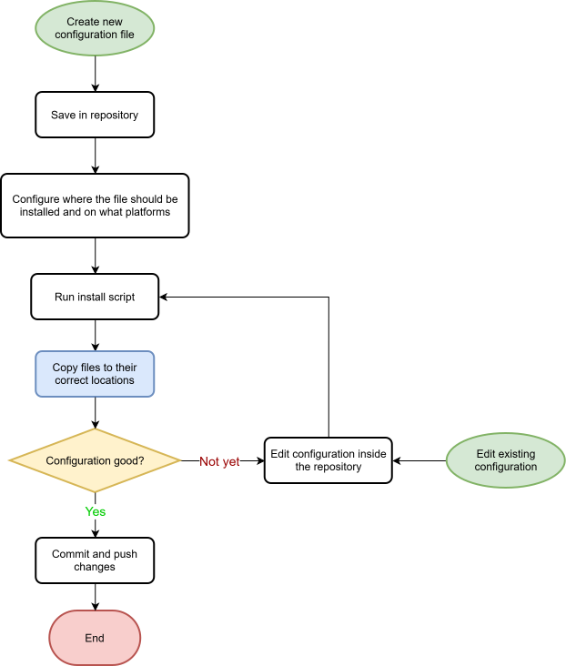

# runtime_components_2

Cross-platform config file manager

## Demo

TODO

## The Problem

[runtime-components](https://github.com/Why-Am/runtime-components) (from CS 193 homework 5) is a cool idea but it does not work on Windows.

I use Windows. I use it because it is the best operating system in 2026, hands down. And I need my config files here too.

## How It Works

- Config files are kept in `configs/`.
- Edit `configuration.py` to specify the install paths for each config file on each operating system.
- Run `install.py` to install the relevant configs.

### Diagrams

### Configuration Install Flow

### User Flow

## Tech Stack

- Language: Python
- Libraries: platform, pathlib, sys, dataclasses
- External tools: git, GitHub
- Data storage: plain text for the configuration files and their backups

## Roadmap

### MVP Scope

- [x] Command line interface
- [x] Install Windows configs
- [x] Install Linux configs

### Future plans

- [x] Dry run
- [x] Install macOS configs
- [ ] Ad hoc install instructions
- [ ] Backup overwritten files
